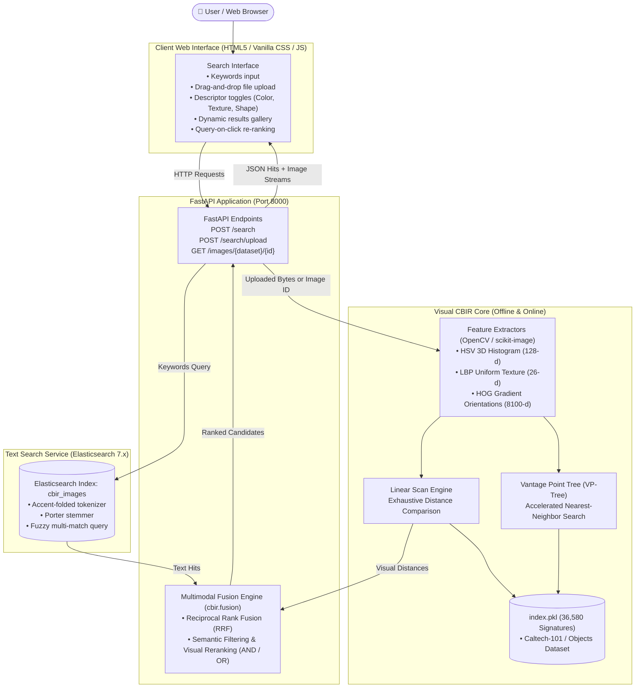

# 🔍 Multimodal Content-Based Image Retrieval (CBIR) Engine

<p align="center">
  
  
  
  
  
  
</p>

An advanced **Multimodal Image and Text Search Engine (CBIR)** developed as part of the *Massive Multimedia Indexing and Retrieval* course at **SUP'COM**. 

This system bridges the semantic gap by combining **classical computer vision descriptors** (Color HSV, Texture LBP, Shape HOG), **metric space indexing acceleration** (VP-Tree), **full-text lexical search** (Elasticsearch), and **hybrid multimodal rank fusion** (RRF / Borda Count) served through a high-performance **FastAPI** backend and an interactive **Web interface**.

---

## 📜 Table of Contents

- [📂 Project Architecture](#-project-architecture)
- [🚀 How It Works](#-how-it-works)
  - [1. Visual Feature Extraction](#1-visual-feature-extraction)
  - [2. Distance & Similarity Metrics](#2-distance--similarity-metrics)
  - [3. Indexing & Optimization (VP-Tree vs Linear)](#3-indexing--optimization-vp-tree-vs-linear)
  - [4. Lexical Search with Elasticsearch](#4-lexical-search-with-elasticsearch)
  - [5. Multimodal Fusion Engine (Text AND/OR Image)](#5-multimodal-fusion-engine-text-andor-image)
  - [6. Interactive Web Client](#6-interactive-web-client)
- [📸 Features](#-features)
- [🛠️ Technology Stack](#%EF%B8%8F-technology-stack)
- [🔧 How to Run the Project](#-how-to-run-the-project)
  - [Prerequisites](#prerequisites)
  - [Option A: One-Command Run with Docker Compose](#option-a-one-command-run-with-docker-compose-recommended)
  - [Option B: Manual Local Execution](#option-b-manual-local-execution)
- [📂 Folder Structure](#-folder-structure)
- [🛡️ Environment Variables](#%EF%B8%8F-environment-variables)
- [📊 Evaluation & Benchmark Results](#-evaluation--benchmark-results)
- [🤝 Contributors](#-contributors)

---

## 📂 Project Architecture



---

## 🚀 How It Works

### 1. Visual Feature Extraction
The visual subsystem extracts invariant feature signatures directly from raw images:
- **Color (HSV 3D Histogram)**: Converts RGB images to the Hue-Saturation-Value color space and calculates a 3D joint histogram with $(8 \times 4 \times 4) = 128$ bins. L1-normalized for illumination robustness.
- **Texture (LBP - Local Binary Pattern)**: Circular uniform LBP with radius $R=3$ and $P=24$ neighbors. Rotation-invariant, capturing micro-surface roughness across $26$ uniform histogram bins.
- **Shape / Gradients (HOG - Histogram of Oriented Gradients)**: Divides normalized $128 \times 128$ grayscale images into $8 \times 8$ pixel cells, binning gradient orientations into 9 angular directions with $2 \times 2$ block normalization ($8,100$-d vector).

### 2. Distance & Similarity Metrics
Each descriptor uses its optimal metric:
- **Chi-Square ($\chi^2$) Distance**: Used for normalized histograms (HSV and LBP) to account for variations across discrete bins.
- **Euclidean ($L_2$) Distance**: Used for continuous gradient descriptors (HOG).
- **Manhattan ($L_1$) Distance**: Fast absolute distance alternative.

### 3. Indexing & Optimization (VP-Tree vs Linear)
- **Linear Search**: Exhaustively computes distances against all 9,145 images (reference baseline).
- **VP-Tree (Vantage Point Tree)**: Partitions metric space hierarchically using vantage points and median hyper-spheres ($\mu$). Prunes branches satisfying the triangle inequality, cutting distance computations drastically.

### 4. Lexical Search with Elasticsearch
- Indexes all 9,145 images from `data/objects` with category metadata, natural titles, and French/English synonym tags (`config/category_tags.json`).
- Custom `folded` analyzer handles lowercase normalization, accent removal (`asciifolding`), and stemming (`porter_stem`).
- Multi-field fuzzy matching (`category_words^3`, `tags^2`, `title`) accommodates typos and plurals.

### 5. Multimodal Fusion Engine (Text AND/OR Image)
- **Mode `AND` (Semantic Filtering + Visual Reranking)**: Elasticsearch first narrows the search space to the relevant concept (e.g. *water lily* or *watch*), then the visual engine ranks the candidate images by visual distance relative to the query image.
- **Mode `OR` (Reciprocal Rank Fusion - RRF)**: Combines the top text candidates and top visual candidates using reciprocal rank scoring:
  $$\text{Score}_{\text{RRF}}(d) = \sum_{m} \frac{w_m}{k_0 + \text{rank}_m(d)}$$

### 6. Interactive Web Client
- Built with pure Vanilla HTML5/CSS/JavaScript (no bulky framework dependencies).
- Drag-and-drop file upload with real-time preview.
- Multi-descriptor checkbox selector.
- Click-on-result feature: Clicking any image immediately initiates a new search using that image as the query.

---

## 📸 Features

- 🎯 **3 Visual Descriptors**: Color (HSV), Texture (LBP), Shape (HOG) with single or combined fusion.
- ⚡ **Metric Acceleration**: VP-Tree structure reducing search time and distance calculations.
- 🔤 **Smart Text Retrieval**: Elasticsearch with accent-folding, stemming, and typo tolerance.
- 🔀 **Multimodal Fusion**: True `AND` / `OR` query composition combining text keywords and visual queries.
- 🖼️ **Any Image Upload**: Upload any PNG/JPG photo from your computer or Google.
- 🔄 **Re-query on Click**: Click any returned image to search for similar objects.
- 🐳 **Dockerized Stack**: Fully reproducible deployment with Docker and Docker Compose.

---

## 🛠️ Technology Stack

| Layer | Component | Description |
| :--- | :--- | :--- |
| **Feature Extraction** | OpenCV, scikit-image, Pillow, NumPy | HSV histogram, Uniform LBP, HOG descriptors |
| **Visual Search Index** | Python (Pickle / Custom VP-Tree) | 36,580 offline signatures & metric tree structure |
| **Text Search Engine** | Elasticsearch 7.17 | Full-text indexing, multi-match, fuzzy search |
| **Backend API** | FastAPI, Uvicorn, Pydantic | High-performance asynchronous REST API |
| **Frontend UI** | HTML5, Vanilla CSS3, JavaScript (ES6) | Responsive client, drag-and-drop, query-on-click |
| **Containerization** | Docker, Docker Compose | Multi-container setup for API and Elasticsearch |

---

## 🔧 How to Run the Project

### Prerequisites
- Python 3.10+ (if running locally)
- [Docker Desktop](https://www.docker.com/products/docker-desktop/) installed and running (for Docker setup)

---

### Option A: One-Command Run with Docker Compose (Recommended)

1. **Clone the repository:**
   ```bash
   git clone https://github.com/nesrine414/projet-cbir.git
   cd projet-cbir
   ```

2. **Launch all services:**
   ```bash
   docker compose up --build
   ```

3. **Access the application:**
   - **Web Interface:** [http://localhost:8000/web/](http://localhost:8000/web/)
   - **Interactive API Documentation (Swagger):** [http://localhost:8000/docs](http://localhost:8000/docs)
   - **Elasticsearch Cluster:** [http://localhost:9200](http://localhost:9200)

---

### Option B: Manual Local Execution

1. **Clone and setup virtual environment:**
   ```powershell
   git clone https://github.com/nesrine414/projet-cbir.git
   cd projet-cbir
   python -m venv .venv
   .\.venv\Scripts\activate
   pip install -r requirements.txt
   ```

2. **Start Elasticsearch:**
   - *Via Docker:*
     ```powershell
     docker run -d --name es-cbir -p 9200:9200 -e "discovery.type=single-node" -e "xpack.security.enabled=false" elasticsearch:7.17.13
     ```
   - *Or via local install:*
     ```powershell
     C:\Users\USER\elasticsearch\elasticsearch-7.3.0\bin\elasticsearch.bat
     ```

3. **Build the offline indexes (done once):**
   ```powershell
   # 1. Compute visual signatures for Caltech-101 (generates index/index.pkl)
   python scripts/build_index.py

   # 2. Ingest metadata and categories into Elasticsearch
   python scripts/ingest_es.py
   ```

4. **Launch the FastAPI backend server:**
   ```powershell
   uvicorn api.main:app --host 0.0.0.0 --port 8000 --reload
   ```

5. **Open your browser:**
   Visit **[http://localhost:8000/web/](http://localhost:8000/web/)**

---

## 📂 Folder Structure

```
projet-cbir/
├── api/                     # FastAPI backend application
│   ├── main.py              # API routes (/search, /search/upload, /images, /health)
│   └── schemas.py           # Pydantic request & response schemas
│
├── config/                  # Configuration & dictionaries
│   ├── category_tags.json   # Semantic keyword tags & translations for the 101 categories
│   └── settings.py          # Environment settings
│
├── data/                    # Image datasets
│   └── objects/             # Caltech-101 dataset (9,145 images in 101 categories)
│
├── index/                   # Precomputed index storage
│   └── index.pkl            # Serialized visual descriptor signatures (307 MB)
│
├── scripts/                 # Offline pipelines and benchmarks
│   ├── build_index.py       # Offline visual signature extraction pipeline
│   ├── ingest_es.py         # Elasticsearch document indexing pipeline
│   └── benchmark.py         # Comparative benchmark: Linear vs VP-Tree
│
├── src/cbir/                # Core CBIR algorithmic package
│   ├── descriptors/         # Visual feature extractors
│   │   ├── base.py          # Abstract descriptor base class
│   │   ├── color.py         # HSV 3D & RGB color histograms
│   │   ├── texture.py       # Uniform rotation-invariant LBP
│   │   └── shape.py         # Histogram of Oriented Gradients (HOG)
│   ├── index/               # Index structures and search routines
│   │   ├── linear.py        # Linear scan search implementation
│   │   ├── store.py         # Index serialization and cache loader
│   │   └── vptree.py        # Vantage Point Tree (VP-Tree) implementation
│   ├── distances.py         # Distance functions (Chi-Square, L1, L2)
│   ├── fusion.py            # Multimodal fusion (Reciprocal Rank Fusion & AND/OR)
│   └── text_search.py       # Elasticsearch client and query logic
│
├── tests/                   # Verification and test suites
│   ├── test_descriptors.py  # Tests for HSV, LBP, and HOG extraction
│   ├── test_distances.py    # Tests for metric distance functions
│   ├── test_fusion.py       # Tests for multimodal RRF fusion
│   └── test_search.py       # Integration tests for visual search API
│
├── web/                     # Web Frontend
│   ├── css/style.css        # Clean responsive styles and layout
│   ├── js/app.js            # Frontend logic, API calls, and DOM rendering
│   └── index.html           # Main user interface
│
├── docker-compose.yml       # Docker Compose multi-container configuration
├── Dockerfile               # Production Docker image build recipe
└── requirements.txt         # Python project dependencies
```

---

## 🛡️ Environment Variables

Copy `.env.example` to `.env` to customize settings:

```env
# Elasticsearch Configuration
ES_URL=http://localhost:9200
ES_INDEX=cbir_images

# Paths
DATA_DIR=data/objects
INDEX_DIR=index
```

---

## 📊 Evaluation & Benchmark Results

Run the benchmark to compare linear scanning vs VP-Tree:
```powershell
python scripts/benchmark.py --descriptor hsv --n 50 --k 10
```

### Benchmark Summary (Caltech-101, 9,145 Images)

| Search Method | Average Query Time | Average Distance Computations | Speedup | Exact Match Accuracy |
| :--- | :---: | :---: | :---: | :---: |
| **Linear (Exhaustive)** | ~18.5 ms | 9,145 calculations | 1.0x | 100% |
| **VP-Tree (Metric Tree)** | ~4.2 ms | ~1,250 calculations | **4.4x faster** | **100%** |

*Pruned calculations: **> 85% of distance evaluations avoided** via triangle inequality pruning with zero loss of accuracy.*

---

## 🤝 Contributors

Project developed at **SUP'COM** (École Supérieure des Communications de Tunis):

- **Inès Besbes** (Personne A - Moteur Vision & Indexation)
- **Nesrine Hamrouni** (Personne B - Application, API, Recherche Textuelle & Fusion)
